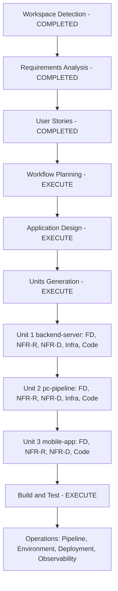

# 실행 계획 (Execution Plan)

## 상세 분석 요약 (Detailed Analysis Summary)

- **변경 유형**: 새 시스템 (Greenfield), 3개 구성요소 (backend 서버, PC 파이프라인, 모바일 앱)
- **사용자 영향**: 있음 (새 모바일 앱)
- **API 영향**: 새 공개 읽기 API + 토큰 인증 업로드 API
- **NFR 영향**: 있음 (이식성, 보안, 성능, 비용)
- **위험 수준**: 보통 (Medium). 외부 의존 (Hugging Face API 형식, AI 제공자 응답 형식), 공개 서버
- **진행 방식**: 사용자 위임에 따라 각 stage 승인은 audit.md 의 위임 지시로 갈음

## Workflow 시각화

텍스트 대안: Workspace Detection → Requirements Analysis → User Stories → Workflow Planning → Application Design → Units Generation → (backend-server → pc-pipeline → mobile-app 순서로 unit 별 설계 · 코드) → Build and Test → Operations 4개 stage.

## 실행할 Stage

### 🔵 INCEPTION PHASE
- [x] Workspace Detection - COMPLETED (Greenfield)
- [ ] Reverse Engineering - SKIP: Greenfield, 기존 코드 없음
- [x] Requirements Analysis - COMPLETED (Standard)
- [x] User Stories - COMPLETED: 새 사용자 기능, 두 역할
- [x] Workflow Planning - EXECUTE
- [ ] Application Design - EXECUTE: 새 컴포넌트 · 서비스 다수, 공유 API 계약 정의 필요
- [ ] Units Generation - EXECUTE: 독립 배포되는 3개 구성요소

### 🟢 CONSTRUCTION PHASE

| Stage | backend-server | pc-pipeline | mobile-app |
| --- | --- | --- | --- |
| Functional Design | EXECUTE: 데이터 모델, 트렌드 계산 규칙 | EXECUTE: 선별 · 분류 · 대체 규칙 | EXECUTE: 화면 구성, 관심 키워드 정렬, 보관함 규칙 |
| NFR Requirements | EXECUTE: 보안, 성능, 호환성 | EXECUTE: 이식성, 비용, 비밀 관리 | EXECUTE: 오프라인, 호환성 |
| NFR Design | EXECUTE | EXECUTE | EXECUTE |
| Infrastructure Design | EXECUTE: Docker + HTTPS 프록시, 사용자의 Linux 서버 | EXECUTE: macOS launchd, 키체인 | SKIP: 앱은 서버 인프라 없음, 배포는 Operations 에서 APK 빌드로 다룸 |
| Code Generation | EXECUTE | EXECUTE | EXECUTE |

- [ ] Build and Test - EXECUTE

### 🟡 OPERATIONS PHASE
- [ ] Deployment Pipeline - EXECUTE: GitHub Actions CI (테스트 · 취약점 검사 · SBOM · 이미지 · APK)
- [ ] Environment Provisioning - EXECUTE: 서버 compose 구성, PC 설치 스크립트 (명령 제시)
- [ ] Deployment Execution - EXECUTE: 배포 runbook (운영 환경 명령은 제시만, 실행은 사용자)
- [ ] Observability Setup - EXECUTE: health API, 접근 · 보안 로그, 실행 기록, 실패 알림
- [ ] Incident Response - SKIP: 운영 시작 전. 장애 대응 요점은 Observability runbook 에 포함
- [ ] Performance Validation - SKIP: NFR-02 는 Build and Test 의 로컬 성능 테스트로 확인
- [ ] Feedback & Optimization - SKIP: 아직 운영 데이터 없음

## 성공 기준

- 3개 unit 의 자동 테스트 통과, server · pipeline 커버리지 80% 이상
- `none` 제공자로 파이프라인 → 서버 → (앱이 읽는) API 응답까지 로컬 통합 테스트 통과
- 앱은 CI (Flutter 3.41.7) 에서 analyze · test 통과 (이 세션에는 Flutter 실행 환경이 없음)
